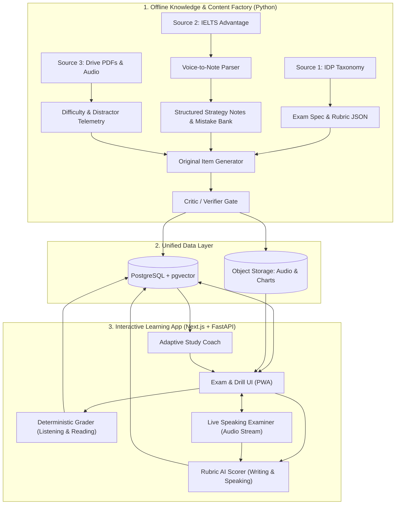
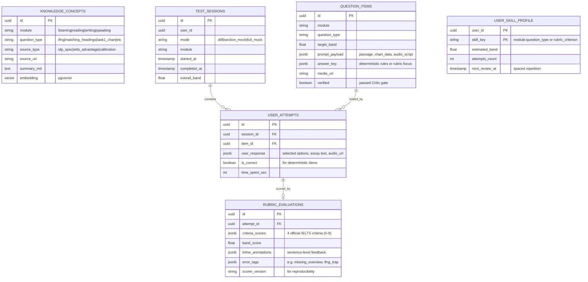

# IELTS Academic Learning App — Architecture & Antigravity Build Blueprint

> [!NOTE]
> This blueprint is designed specifically for a **scientist building a high-quality side project** in **Google Antigravity**: low DevOps overhead, rigorous evaluation/calibration of AI scoring (treating grading like a measurement instrument), clean copyright hygiene, and an incremental MVP build plan.

---

## 1. Source Strategy & Copyright Hygiene

Your three sources map cleanly to **three distinct architectural roles**. Separating them prevents copyright issues while maximizing pedagogical quality and exam realism:

| Source | Architectural Role | What to Extract | What NOT to Do |
| :--- | :--- | :--- | :--- |
| **1. IDP IELTS Academic** (`ielts.idp.com`) | **Official Taxonomy & Rubric Spec** | Exact 4-section structure, timing, word limits, all official question types (e.g., Reading *T/F/NG*, *Matching Headings*; Writing *Task 1/2*; Speaking *Parts 1–3*), and public Band Descriptors. | Don't invent non-standard question formats that diverge from the real test. |
| **2. IELTS Advantage** (`youtube.com/@Ieltsadvantage`) | **Pedagogy, Strategy & Mistake Taxonomy** | Frameworks (e.g., essay structures, Task 1 overview techniques, Speaking fluency habits), common Band 6 → 8 pitfalls, and drill concepts via a **Voice/Video-to-Note Parser**. You can also **embed official YouTube videos** with attribution via the YouTube IFrame API. | Don't scrape/re-host video files or copy verbatim scripts as your own text. Synthesize structured original study notes and cite the channel + video timestamp. |
| **3. Google Drive Folder** (Prior Official PDFs & Audio) | **Calibration & Style Reference Corpus (Offline Only)** | Structural telemetry: passage lengths (~700–900 words), academic vocabulary/CEFR profile, distractor mechanics (e.g., self-corrections in Listening), audio speech rate & accent mix, and difficulty curves across Sections 1–4. | **Never copy or serve verbatim passages, questions, or audio files** in the app database. Use them purely to calibrate original content generation and scoring benchmarks. |

### Source #3 Audit Findings (Google Drive `Cambridge IELTS`)
Using the connected Google Drive plugin, we verified that your folder contains **Cambridge IELTS 1–19** (Academic PDFs + segmented Listening MP3s, e.g. `T1 P1`–`T4 P4` in Book 19). This unlocks three specific planning optimizations for your offline calibration pipeline:
* **Prioritize Books 15–19 (Academic only):** Books 15–19 match the current post-2020 IELTS Academic format (Listening uses *Parts 1–4* without the removed Part 1 spoken example). Filter out General Training PDFs and stray non-IELTS files (e.g., a CAE PDF inside Book 19) during ingestion.
* **Built-in Scientific Benchmark for Writing Calibration:** Cambridge IELTS Academic books include official sample Writing responses with **examiner comments and band scores** at the back — ideal for building your private offline validation benchmark (`MAE ≤ 0.5`, `QWK ≥ 0.80`) without copying exam text into the production app.
* **Pre-Segmented Audio Telemetry:** Per-part MP3 files (`T1 P1`–`T4 P4`) make it straightforward to measure exact speech rate (WPM), pause intervals, and Part 1–4 difficulty scaling in Python to calibrate your own generated Listening tracks.

### Source #2 Pipeline: Voice/Video-to-Structured-Note Parser (IELTS Advantage)
Because Source #2 is video/spoken instruction, build a dedicated **Voice-to-Note Parser** in `pipelines/` before generating drills or lessons:
1. **Ingest:** Fetch video metadata + captions/transcript (or extract audio via `yt-dlp` when captions are missing/noisy, then transcribe via Gemini native audio).
2. **Parse & Structure (Gemini Flash — Structured JSON):** Convert raw spoken narration into clean, searchable Markdown + JSON notes with a strict schema:
   * `module` (`reading` | `listening` | `writing` | `speaking`) & `question_type`
   * `core_strategy_steps` (numbered actionable framework)
   * `common_mistakes` (what keeps learners stuck at Band 6.0–6.5)
   * `band_upgrade_patterns` (concrete Band 6 → Band 8 techniques & paraphrasing examples)
   * `timestamp_anchors` (deep links back to exact moments in the original YouTube video)
3. **Index:** Save clean notes in `data/notes/` and embed them into PostgreSQL (`pgvector`) so the app's Distractor Explainer, Writing Feedback, and Adaptive Coach cite real IELTS Advantage strategies with clickable video timestamps.

---

## 2. Recommended Tech Stack (Scientist-Friendly)

IELTS Academic is best practiced on a **desktop/tablet web interface** (split-pane Reading passage + questions, Writing editor with live word count & timer, Listening audio synced with forms/maps) — mirroring the official computer-delivered IELTS exam. Build a **Web-First Progressive Web App (PWA)** first; it runs on laptops and phones without App Store friction.

| Layer | Recommended Choice | Why It Fits This Project |
| :--- | :--- | :--- |
| **Frontend** | **TypeScript + Next.js (App Router) + Tailwind CSS + shadcn/ui** | Fast UI scaffolding, clean split-pane exam layouts, built-in routing, and easy PWA support. |
| **Backend & AI Pipeline** | **Python + FastAPI** | Ideal for a scientist: best ecosystem for PDF/audio reference analysis (`pymupdf`, `librosa`), YouTube transcript ingestion, statistical scoring evals (MAE / Kappa), and structured AI orchestration. |
| **Database & Vectors** | **PostgreSQL + `pgvector`** (via **Supabase** or **Neon**) | One database handles relational tables, user auth, and semantic search over your strategy/mistake knowledge base. Start with local SQLite/Postgres during MVP if preferred. |
| **Media Storage** | **Supabase Storage** or **Cloudflare R2** | Stores generated Listening audio (MP3/WAV), Writing Task 1 charts/diagrams (SVG/PNG), and user Speaking recordings. |
| **AI & Native Audio** | **Gemini API** (Multimodal + Live API) | Native audio input means the model hears *actual* pronunciation, intonation, stress, and pauses (critical for Speaking) rather than judging a lossy text transcript. Also natively inspects Task 1 charts/maps alongside essays. |
| **Listening TTS & Charts** | **Multi-speaker Neural TTS** (e.g., Google Cloud TTS / Gemini TTS) + **Python Matplotlib / SVG / Vega-Lite** | Generates multi-accent Listening dialogues (UK, AU, US, CA) and crisp, data-accurate Task 1 line graphs, bar charts, tables, and process diagrams from structured JSON. |

---

## 3. System Architecture & Database Flow

### High-Level Architecture

### Core Database Schema

> [!TIP]
> Notice `scorer_version` on `RUBRIC_EVALUATIONS`. As a scientist, version your prompts and rubric models like experiment runs so you can compare grading drift over time and re-score historical attempts if you improve the rubric.

---

## 4. Scoring Engine Design (All 4 Modules)

A common mistake in AI learning apps is sending *everything* to an LLM. Split scoring strictly between **deterministic rules** and **rubric-grounded multimodal AI**:

### A. Listening & Academic Reading — 100% Deterministic Scoring
* **Normalization Rules:** Case-insensitive comparison, UK/US spelling equivalence (`colour`/`color`), numeric equivalence (`3`/`three`), optional parentheticals, and strict word-limit enforcement (e.g., *"NO MORE THAN TWO WORDS AND/OR A NUMBER"*).
* **Official Band Mapping:** Map raw score (`0–40`) → Band `1.0–9.0` (0.5 increments) using the separate official Listening and Academic Reading conversion curves.
* **AI Role (On-Demand Only):** When the user gets an item wrong, an AI tutor highlights the exact evidence span in the passage/transcript and explains the *distractor mechanism* (e.g., why *"False"* differs from *"Not Given"*).

### B. Academic Writing — Multi-Criteria Multimodal Scoring
* **Task 1 (Visual Report, ≥150 words, 1/3 weight):** Pass **both the chart/diagram image (plus its underlying JSON data)** and the user's essay to the model so it can objectively verify whether reported numbers, trends, and comparisons are factually accurate.
  * Criteria: *Task Achievement (TA)*, *Coherence & Cohesion (CC)*, *Lexical Resource (LR)*, *Grammatical Range & Accuracy (GRA)*.
* **Task 2 (Academic Essay, ≥250 words, 2/3 weight):**
  * Criteria: *Task Response (TR)*, *Coherence & Cohesion (CC)*, *Lexical Resource (LR)*, *Grammatical Range & Accuracy (GRA)*.
* **Scoring Mechanics:**
  * Enforce structured JSON output: per-criterion band (`0–9`), exact quote-backed evidence for each score, 3 highest-leverage improvements (referencing relevant IELTS Advantage strategy concepts), and a Band +1 rewrite of one weak paragraph.
  * Compute final Writing band mathematically in code: `(Task1 + 2 * Task2) / 3`, rounded to nearest `0.5`.

### C. Speaking — Two-Stage Native Audio Architecture
* **Stage 1 (Live Examiner):** Real-time audio conversation following the strict IELTS script:
  * *Part 1* (4–5 min): Familiar topics (work/study/hometown).
  * *Part 2* (3–4 min): Display cue card + 1-minute prep timer + 2-minute uninterrupted recording.
  * *Part 3* (4–5 min): Abstract follow-up questions dynamically linked to the Part 2 topic.
* **Stage 2 (Post-Session Acoustic & Rubric Grader):** Feed the **raw audio recording + timestamps + transcript** into a high-reasoning multimodal model to score:
  * *Fluency & Coherence (FC)* — detects hesitations, self-corrections, and speech rate directly from audio.
  * *Lexical Resource (LR)* — idiomaticity, collocations, paraphrasing.
  * *Grammatical Range & Accuracy (GRA)* — complex clauses, tense consistency.
  * *Pronunciation (P)* — phonemes, word stress, intonation, intelligibility *(only possible with native audio input, never text-only!)*.

> [!IMPORTANT]
> **Scientific Calibration Step (Do This Early!):** Before trusting your AI Writing/Speaking scores, assemble a small local validation set of 20–30 public IELTS sample essays/recordings with known band scores (e.g., official IDP/British Council band exemplars and IELTS Advantage graded breakdowns). Run your scorer in Python and measure **Mean Absolute Error (MAE ≤ 0.5 bands)** and **Quadratic Weighted Kappa (QWK ≥ 0.80)**. Tune prompts and few-shot anchors using data, not guesswork.

---

## 5. Should You Use AI Agents?

**Yes — selectively.** Do not build an over-engineered multi-agent swarm where simple code or a single structured API call is faster, cheaper, and more reliable.

| App Capability | Use an Agent? | Recommended Pattern |
| :--- | :--- | :--- |
| Reading / Listening grading & band math | **No** | Deterministic Python/TS functions + unit tests. |
| Single-essay Writing scoring | **No** (use a **Structured Pipeline**) | 2-step deterministic workflow: `Rubric Scorer` (JSON schema) → `Fact/Constraint Checker` (verifies word count, chart numbers, and band math). More reproducible than an open-ended agent. |
| **Offline Content Factory** (creating original passages, charts, audio scripts) | **Yes** | **Generator + Critic workflow**: Researcher pulls IDP spec + IELTS Advantage pitfalls → Generator drafts original test item → Critic checks for ambiguous keys, accidental copying, and target CEFR level before saving. |
| **Live Speaking Examiner** | **Yes** | Stateful conversational audio agent that tracks Part 1/2/3 timers, manages turn-taking, and adapts Part 3 follow-ups to the user's Part 2 answers. |
| **Adaptive Study Coach** | **Yes (Lightweight)** | Tool-calling agent that queries `USER_SKILL_PROFILE` and `RUBRIC_EVALUATIONS` to diagnose recurring weaknesses (e.g., *"You lose 1.0 band on Task 1 by omitting an Overview"*) and queues targeted drills + relevant IELTS Advantage videos. |

---

## 6. How to Build This Using Antigravity (Beginner Playbook)

Since you are new to Antigravity, here is the highest-leverage way to organize your workspace, customizations, and build phases so the platform works *with* you like a disciplined engineering team.

### Step 1: Workspace & Project Rules Setup (Completed)
* **Dedicated Workspace Created:** `/Users/930425/.gemini/antigravity/scratch/ielts-lab` (set this folder as your active workspace in Antigravity).
* **Workspace Rules Configured:**
  * `AGENTS.md` (root always-on guardrails: allowed sources, copyright hygiene, tech stack, deterministic-first scoring, and testing standards).
  * `.agents/rules/ielts-rubrics.md` (official IELTS Academic scoring specs, band-rounding math, and Milestone 1–4 ordering).
  * `.gitignore` configured to permanently exclude `data/private_reference/` so downloaded Cambridge reference PDFs/MP3s can never be committed.
* **Plugins Connected:** Both **Google Drive** (`gdrive`) and **Gemini API** (`gemini-api`) plugins are installed and ready.

### Step 2: Use the Right Antigravity Slash Commands & Features by Phase

| Build Phase | What You Are Doing | Best Antigravity Feature / Slash Command |
| :--- | :--- | :--- |
| **Phase 0: Requirements & MVP Scope** | Lock down features (local vs. hosted, auth, which module ships first) | **`/grill-me`** (interactive design interview) followed by **`/plan`** (generates an executable step-by-step plan before any code is written). |
| **Phase 1: Source Ingestion & Calibration** | Inspect Source 1 taxonomy, map Source 2 IELTS Advantage playlist topics, analyze Source 3 Drive PDFs/audio stats | **Research subagents** or Python batch scripts via **`run_workflow`** to summarize multiple reference files in parallel without cluttering your main chat. |
| **Phase 2: Vertical Slice Implementation** | Build one complete module end-to-end before starting the next (recommended order: **Reading → Listening → Writing → Speaking**) | **Agent Mode** in Antigravity 2.0 / IDE for multi-file features; **Inline Command (`⌘+I`)** in Antigravity IDE for quick localized edits; **Artifacts** to track architecture & eval logs. |
| **Phase 3: UI & UX Verification** | Test split-pane Reading layout, timers, audio playback, and responsive layout visually | **`/browser`** (built-in Browser subagent) to open `localhost:3000`, click through a real practice test, and verify UI state and console errors automatically. |
| **Phase 4: Hard Problems & Scoring Calibration** | Calibrate Writing/Speaking AI scorer against ground-truth exemplars, debug WebSocket audio streaming | **`/boost`** (deep thinking, multi-perspective verification) or **`/goal`** (thorough autonomous execution for long test/eval suites). |
| **Ongoing Maintenance** | Keep context clean and teach Antigravity your preferences | **`/learn`** whenever you correct a mistake so it persists; **`/compact`** when a long conversation starts filling up context; **`@` mentions** to attach specific files/rules directly. |

---

## 7. Optimal Model-to-Workflow Routing

It helps to think about **two separate model routing tables**: (A) which models to choose *inside Antigravity* while building, and (B) which models your *IELTS app* calls at runtime.

### A. Inside Antigravity (While Building the App)

| Development Task | Optimal Model Tier | Why |
| :--- | :--- | :--- |
| Architecture, DB schema, prompt/rubric design, complex audio WebSocket debugging, eval analysis | **High-Reasoning / Pro / Top-Tier** (e.g., Gemini Pro / Gemini 4 High) | Deep multi-file reasoning, fewer subtle logic bugs, much better rubric design. |
| Scaffolding React/Next.js components, CRUD endpoints, writing unit tests, Tailwind styling, docstrings | **Fast / Flash Tier** (e.g., Gemini Flash) | High speed, low latency, ideal for well-specified repetitive implementation work. |
| Browser UI testing & visual verification | **Flash Tier** (default for Antigravity's browser subagent) | Fast multi-step DOM navigation and visual checks. |
| Batch processing Source 2 transcripts & Source 3 reference PDFs into calibration stats | **Flash / Flash-Lite Tier** (via parallel subagents or workflows) | High throughput and cost efficiency across dozens of documents. |

### B. Inside Your IELTS App (Production Runtime)

| App Runtime Feature | Optimal Model Tier | Estimated Cost / Latency Profile |
| :--- | :--- | :--- |
| Listening & Reading grading, timers, word count, band math | **No LLM (Pure Code)** | Zero cost, <5 ms latency, 100% deterministic. |
| Live Speaking Examiner conversation (Parts 1–3) | **Gemini Live API (Flash / Native Audio)** | Ultra-low latency streaming audio turn-taking. |
| Instant hints, Reading/Listening distractor explanations, Study Coach queries | **Gemini Flash** (with structured JSON output) | Very low cost, fast (<2 s), great for RAG over IELTS Advantage concepts. |
| Final Writing Task 1 (image + text) & Task 2 scoring, Post-session Speaking audio scoring | **Gemini Pro** (Multimodal, structured JSON) | Higher accuracy and rubric consistency; 5–10 s wait is completely natural after submitting an essay or speaking test. |
| Offline batch generation of new original test items | **Gemini Pro (Generator + Critic)** | Run once offline; cost is amortized across every future practice session. |

---

## 8. Suggested 4-Milestone MVP Roadmap

Ship **vertical slices** in order of increasing AI complexity — completing both **100% deterministic modules first**, then adding calibrated AI grading and real-time audio:

1. **Milestone 1 — Foundation + Academic Reading MVP (Weeks 1–2):**
   * IDP Academic taxonomy JSON, Source #2 Voice-to-Note parser prototype, and Source #3 (Books 15–19 Academic) telemetry script.
   * Split-pane Reading UI (passage left, questions right, highlightable text, 60-min timer) + deterministic grader + distractor explanation drawer linked to parsed IELTS Advantage notes.
2. **Milestone 2 — Listening Module (Week 3):**
   * Deterministic Listening grader (normalization, UK/US spelling, strict word-limit rules, 0–40 band table).
   * Multi-speaker Listening audio generation pipeline calibrated to Cambridge Books 15–19 `P1–P4` pacing and distractor patterns + synced Listening UI (forms, maps, MCQs).
3. **Milestone 3 — Academic Writing + Calibrated AI Scorer (Weeks 4–5):**
   * Task 1 chart/diagram renderer + Task 2 editor with live word count & timer.
   * Python eval benchmark using private offline examiner-annotated samples (Books 15–19) + IELTS Advantage graded breakdowns; calibrate the Gemini Pro 4-criteria rubric scorer until `MAE ≤ 0.5` bands and `QWK ≥ 0.80`.
4. **Milestone 4 — Live Speaking Examiner + Adaptive Coach (Weeks 6–7):**
   * Real-time audio Speaking test (Parts 1–3) using Gemini Live API + post-session multimodal audio rubric grader + personalized Study Coach linking weak skills to parsed IELTS Advantage notes & video timestamps.
